# Comedically Online

Demo video: https://www.youtube.com/watch?v=hc-pmiVbB6c

*Built during the Meta AI Developer Hackathon, theme: Build for Your World. AI uses only Meta models.*

**Live comedy. Moderated by someone who gets the joke.**

## Why I built this

I never had the chance to watch the world's famous comedians perform live, because
they rarely come to my country. I wanted a place where new comedians can promote
themselves and world-famous comedians can run extra shows for fans everywhere. But
live comedy has a problem: generic moderation kills streams over a joke, a word, or a
gesture. So I built Comedically Online: comedy-aware moderation where each show runs
under a rulebook the comedian accepts, enforced live on a 12-second delay.

Comedically Online is a live-streaming platform built only for stand-up comedians — and
the moderation is the product. A comedian's act lives or dies on provocative material,
so blunt keyword filters or human moderators who "don't get the bit" either censor the
jokes or let real harm through. Comedically Online instead runs every live broadcast
through a comedy-aware AI moderation pipeline: speech and video are checked against a
small, explicit rulebook, and only the offending word or gesture is hidden — muted or
blurred in place — while the show itself is never cut.

The demo uses harmless stand-ins only (an invented banned word, a three-finger gesture,
a nose touch), never real explicit content.

> **Only Meta models are used for AI.** Speech: Meta Voice Transcribe (file) and the
> Meta realtime ASR WebSocket. Vision + judgement: `muse-spark-1.3`. No OpenAI, no
> third-party AI APIs anywhere in the pipeline.

> Legal pages (`/terms`, `/privacy`, `/cookies`, `/community-guidelines`,
> `/moderation-policy`) are **template drafts**. They must be reviewed by a lawyer
> before launch. Nothing here claims legal compliance.

<!-- Screenshot: landing page hero with spotlight styling and CTAs. File: docs/images/landing.png -->
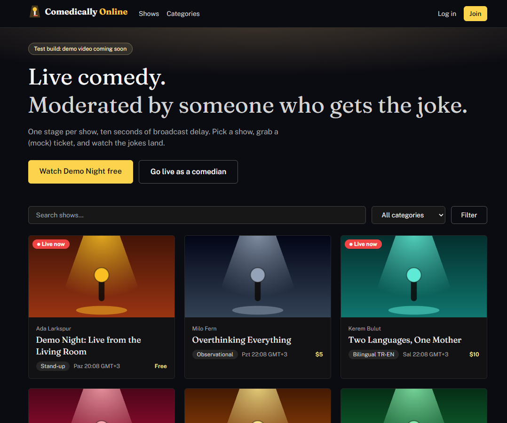
*The landing page: dark stage-spotlight hero, "Watch live" and "Go live as a comedian".*

## Table of contents

- [Why I built this](#why-i-built-this)
- [How it works (60 seconds)](#how-it-works-60-seconds)
- [The rulebook](#the-rulebook)
- [Architecture](#architecture)
- [Meta models: exactly what runs where](#meta-models-exactly-what-runs-where)
- [Comedian vs. viewer](#comedian-vs-viewer)
- [Measured numbers](#measured-numbers)
- [Env vars](#env-vars)
- [Setup and run](#setup-and-run)
- [Testing](#testing)
- [Limitations and honest tradeoffs](#limitations-and-honest-tradeoffs)
- [Site features (beyond moderation)](#site-features-beyond-moderation)
- [Project structure](#project-structure)

## How it works (60 seconds)

1. A comedian creates a show, opens its **prepare page**, reads the rulebook, and
   accepts it (acceptance is stored per rulebook version; the go-live API refuses
   without it).
2. They hit **Go live**. The studio captures webcam/mic and sends 2-second WebM
   chunks plus parallel 16kHz WAV audio over one WebSocket.
3. The server moderates every chunk — speech via realtime ASR, video via a Spark
   vision classifier — and releases chunk + decisions to viewers exactly **12
   seconds** after capture.
4. Viewers see a 10-second "the comedian has started" countdown, then the delayed
   stream. Banned words are muted in place; flagged gestures are blurred in place.
   The stream is never cut.
5. When the show ends, viewers watch the 12s buffer drain, then get an ended screen
   with **no replay**. The comedian gets a censored-moments recap with downloads.

## The rulebook

All moderation rules come from one developer-maintained file,
[`src/moderation/rulebook.json`](src/moderation/rulebook.json) (currently v1.0.0).
Comedians cannot write, edit, or override rules — they read the rulebook and accept it
before every broadcast, and must re-accept when the version changes. Every moderation
event records its rule id, so viewers and comedians always see *why* something was
hidden.

| Rule id | Modality | What it catches | Action |
| --- | --- | --- | --- |
| `banned-word-waffle` | audio | The word "waffle" (harmless stand-in for a banned word), plus Turkish/typo aliases (`vafıl`, `vaffıl`, `vafil`, `vaflındır`, `vaffle`) | bleep (muted in place) |
| `hand-gesture-three` | video | Holding up exactly three fingers toward the camera (stand-in for a rude gesture) | blur (in place) |
| `touching-nose` | video | A fingertip in contact with the nose (stand-in for an offensive visual) | blur (in place) |

How rules flow through the system:

- **Audio rules** feed the realtime ASR keywords, the Turkish-aware fuzzy matcher, the
  overlapping file-transcription fallback, and the Spark judge prompt.
- **Video rules** are compiled into the Spark vision classifier prompt
  (`spark-vision.ts`), one definition per rule with an explicit NOT-a-match clause.
- **Every decision** carries `ruleId` + the rule's user-facing explanation, shown in
  the studio log, the viewer "Why @timestamp" line, and the recap.

<!-- Screenshot: rulebook page with rule cards. File: docs/images/rulebook.png -->
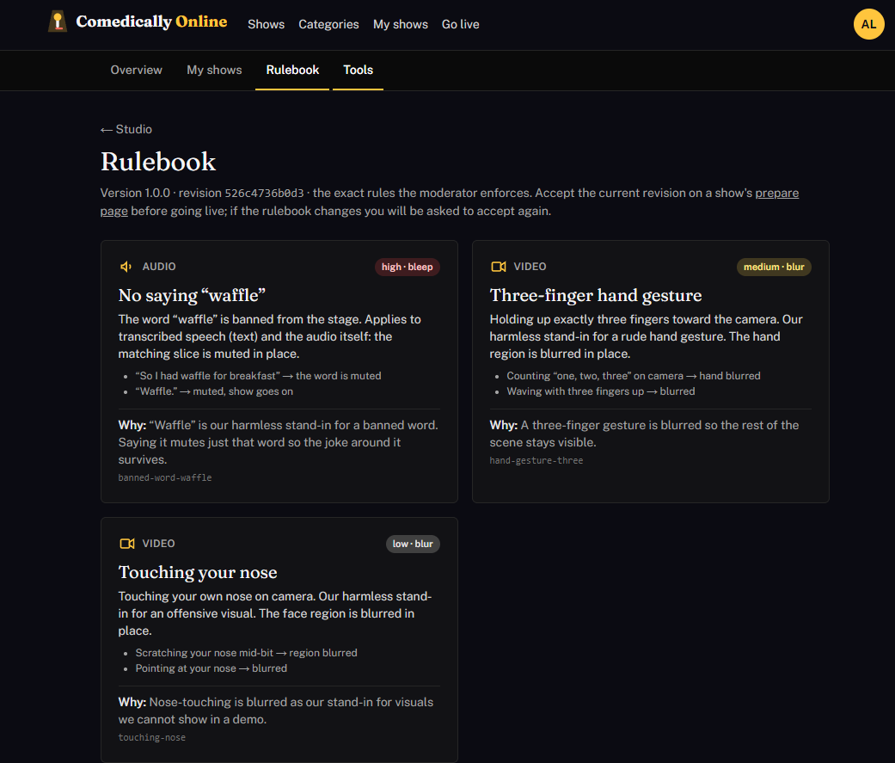
*The rulebook: every rule as a card with modality, action, and examples.*

<!-- Screenshot: pre-live prepare page with the acceptance gate. File: docs/images/prepare-acceptance.png -->
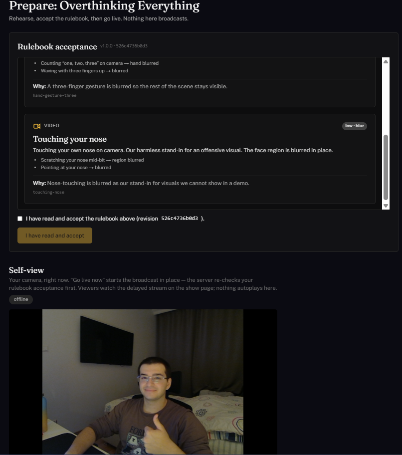
*The prepare page: self-view, rulebook panel, and the acceptance gate before "Go live now".*

## Architecture

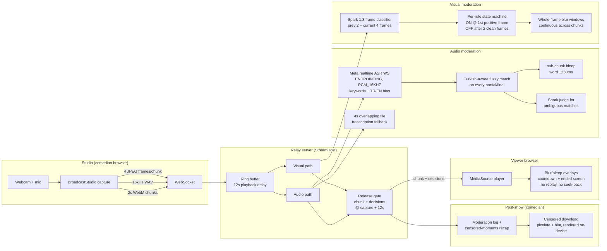

Key properties:

- **Delay, not blocking.** The 12s delay buffer gives the pipeline a fixed time
  budget. If a chunk still isn't moderated at delay + `MAX_HOLD_MS` (4s), it is
  released **censored** (full bleep + full blur) rather than raw or dropped.
- **Fail-closed everywhere.** Transcription errors, vision errors, timeouts, and
  spend-cap trips all censor, never release raw media. Audio fails closed
  unconditionally; video fails closed unless `VISUAL_FAIL_MODE=open` (demo testing
  only). While realtime ASR is down, the studio shows a banner and the file fallback
  covers audio.
- **Late joiners are safe.** Init bytes are only ever sent paired with chunk-0
  decisions; a joiner mid-show gets init + future chunks (the player skips the
  timeline gap and logs it).
- **No replay.** After the end, the player tears down every handle on the media
  (detach, revoke, close sockets) — viewers can't rewatch or seek back into buffers.

<!-- Screenshot: live studio with warning badge. File: docs/images/studio-live-warning.png -->
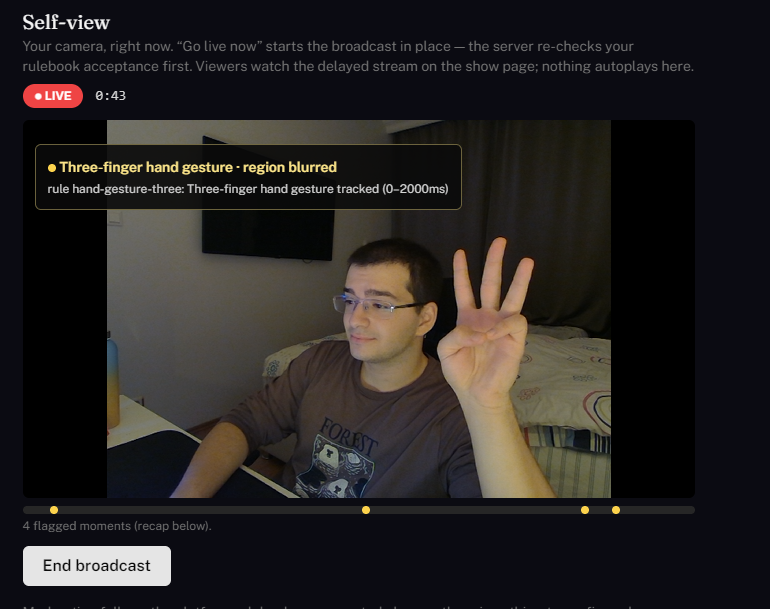
*Live studio: LIVE badge, elapsed timer, viewer view, and a moderation warning badge.*

<!-- Screenshot: studio timeline markers. File: docs/images/studio-timeline.png -->
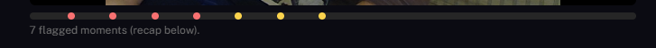
*The studio timeline: censored-moment markers as the show progresses.*

<!-- Screenshot: live moderation log. File: docs/images/studio-modlog.png -->
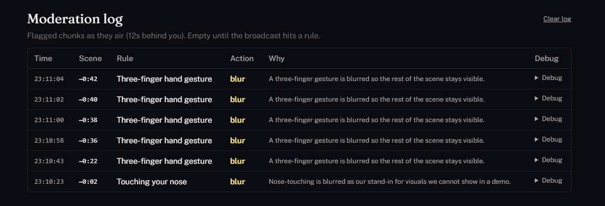
*The live moderation log: time, rule, action, and explanation per event.*

## Meta models: exactly what runs where

| Model | Where | What it does |
| --- | --- | --- |
| **Meta Voice Transcribe** (file) | `src/moderation/transcribe.ts` | Whole-chunk + halves transcription; language ID (TR/EN); 4s overlapping fallback window |
| **Meta realtime ASR** (`wss://api.meta.ai/v1/asr/realtime`) | `src/moderation/realtime.ts` | Live partials/finals over WebSocket (`ENDPOINTING`, `PCM_16KHZ`, rulebook keywords, Turkish+English bias) → lag-corrected sub-chunk bleeps |
| **`muse-spark-1.3`** (vision) | `src/moderation/spark-vision.ts` | One Responses call per chunk over 6 frames; JSON verdicts per rule with confidence; `minimal` effort, `low` 2nd opinion in the unsure band |
| **`muse-spark-1.3`** (judge) | `src/moderation/judge.ts` | Comedy-aware judge: decides whether a flagged word is joke/satire vs a real attack, following the rulebook; ambiguous fuzzy matches consult it within a float budget |
| **`muse-spark-1.3`** (tags) | show creation, `TAG_MODE=live` | 3–6 auto-tags from title + description + categories |
| **SAM 3.1** (optional) | `VISION_BACKEND=sam` | Legacy per-concept segmentation path; kept for comparison, not the default |

Model access is one OpenAI-compatible client pointed at `https://api.meta.ai/v1` with
the key from `MODEL_API_KEY` (never hardcoded, never logged). `npm run smoke` makes
one cheap real call per model (<$0.05 total) to verify shapes.

<!-- Screenshot: blurred three-finger gesture in the viewer. File: docs/images/viewer-blur-fingers.png -->

*Viewer: the three-finger gesture blurred in place with the rule label and "Why" line.*

<!-- Screenshot: blurred nose-touch in the viewer. File: docs/images/viewer-blur-nose.png -->

*Viewer: the nose touch blurred in place; the rest of the scene stays visible.*

<!-- Screenshot: bleep indicator in the viewer. File: docs/images/viewer-bleep.png -->
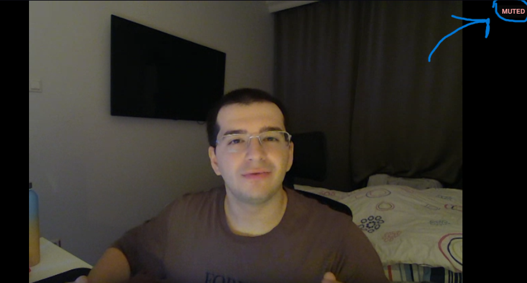
*Viewer: the red "bleep" pill while a banned word is muted, with the reason below.*

## Comedian vs. viewer

The comedian always sees the raw stage; the viewer sees the same moment 12s later,
censored. Three examples, raw view above censored view:

<!-- Screenshot: comedian raw three-finger view. File: docs/images/comedian-fingers.png -->
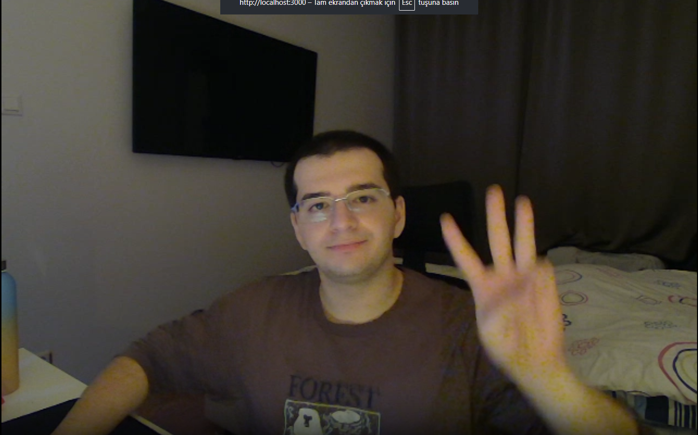
<!-- Screenshot: viewer censored three-finger view. File: docs/images/viewer-blur-fingers.png -->

*Three-finger gesture: raw in the studio, blurred in the viewer 12s later.*

<!-- Screenshot: comedian raw nose-touch view. File: docs/images/comedian-nose.png -->
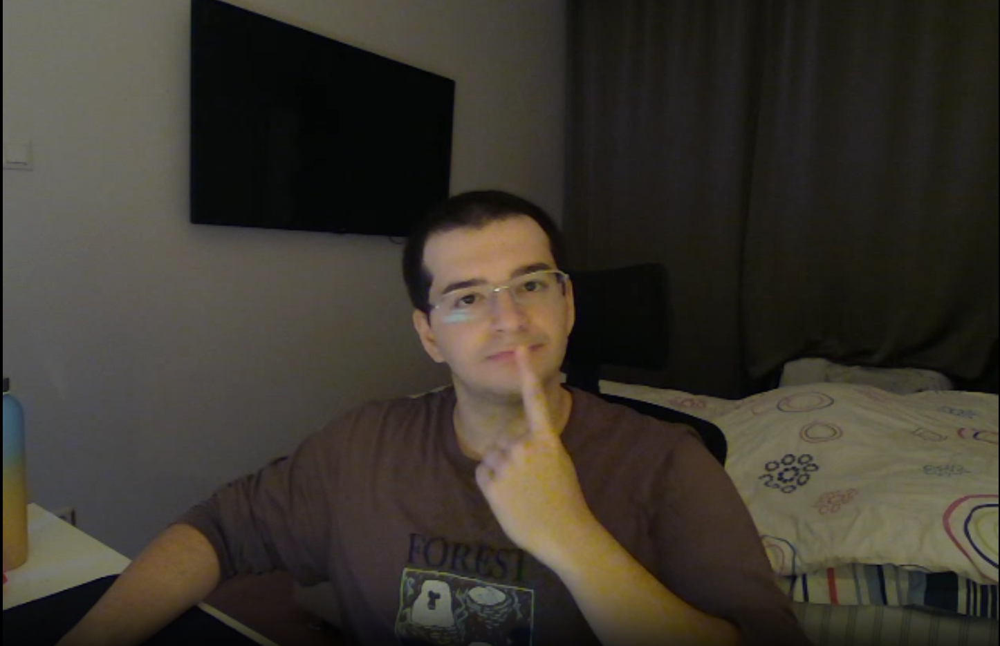
<!-- Screenshot: viewer censored nose-touch view. File: docs/images/viewer-blur-nose.png -->

*Nose touch: raw in the studio, blurred in the viewer 12s later.*

<!-- Screenshot: comedian raw banned-word moment. File: docs/images/comedian-bleep.png -->
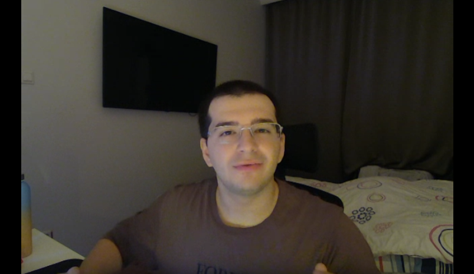
<!-- Screenshot: viewer censored banned-word moment. File: docs/images/viewer-bleep.png -->

*Banned word: heard live in the studio, muted with the "bleep" pill in the viewer 12s later.*

## Measured numbers

From live runs and the eval scripts (see [Testing](#testing)):

- **Vision latency:** Spark classifier ~2.2–3.8s per chunk, worst observed 6.5s —
  inside the 12s delay + 4s hold budget with room (even a 2nd-opinion 2×6.5s still
  lands moderated, just late).
- **Gesture tracker:** a held gesture is one continuous blur window across chunk
  boundaries; the blur lifts ~1s after the last positive frame (2 clean frames).
- **Audio timing:** realtime ASR emission lag measured at 232ms (`REALTIME_LAG_MS`
  default 250); bleeps land ≈ word start−250ms to word end+250ms, one window per
  occurrence.
- **Cost:** about $3–5 per streaming hour (measured ~$2.8/h at 320px frames,
  ~$5/h at 640px, standard Spark pricing); the legacy SAM path measured ~$36/h —
  one reason Spark is the default.
  A per-stream spend tracker + `MAX_SPEND_USD` cap (default $5) falls back to mock
  mode instead of overspending.
- **Tests:** 223 tests / 96 suites green, plus the end-to-end relay proof with the
  real 12s delay (~17s) and strict `tsc --noEmit`.

<!-- Screenshot: viewer countdown. File: docs/images/viewer-countdown.png -->
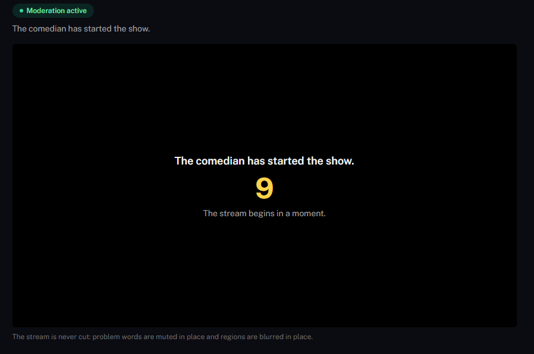
*Joining before the stream reaches you: the 10s "comedian has started" countdown.*

<!-- Screenshot: viewer ended screen. File: docs/images/viewer-ended.png -->
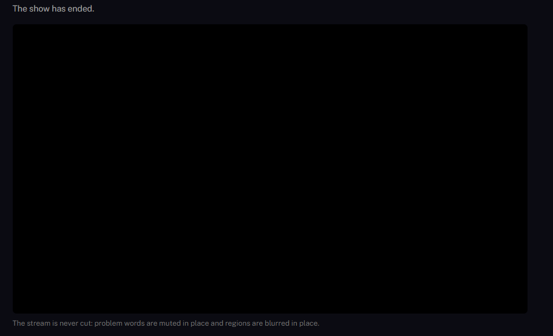
*After the show: the ended screen. No replay, no seek-back — the media is detached.*

## Env vars

| Var | Default | Purpose |
| --- | --- | --- |
| `MODEL_API_KEY` | — | Meta Model API key (baseURL `https://api.meta.ai/v1`). Never logged. |
| `MODERATION_MODE` | `mock` | `mock` = scripted demo decisions (free); `live` = Meta models. |
| `TAG_MODE` | `mock` | `mock` = keyword tags; `live` = muse-spark-1.3 tags. |
| `MAX_SPEND_USD` | `5` | Hard moderation spend cap per stream; over it falls back to mock. |
| `SESSION_SECRET` | dev-only fallback (warns) | HMAC for session cookies. Required in production. |
| `SQLITE_FILE` | `data/comedically.db` | Local SQLite file (gitignored, WAL mode). |
| `NEXT_PUBLIC_SITE_URL` | `http://localhost:3000` | Canonical/OG/sitemap base URL. |
| `PORT` / `PLAYBACK_DELAY_MS` | `3000` / `12000` | Server port / broadcast delay. |
| `MAX_HOLD_MS` | `4000` | Past delay + hold, unmoderated chunks release censored. |
| `VOICE_TIMEOUT_MS` / `SAM_TIMEOUT_MS` / `SPARK_TIMEOUT_MS` | `8000` / `20000` / `8000` | Per-model call timeouts. |
| `SAM_IMAGE_TIMEOUT_MS` | `6000` | SAM image calls: no retries, fail closed fast. |
| `VISION_BACKEND` | `spark` | Live visual path: `spark` / `sam` / `gate`. Legacy `VISUAL_STRATEGY` alias honored when unset. |
| `SPARK_VISION_MODEL` / `SPARK_VISION_EFFORT` | `muse-spark-1.3` / `minimal` | Classifier model + effort (unsure band retries at `low`). |
| `VISION_HIT` / `VISION_UNSURE` | `0.5` / `0.3` | Blur at ≥HIT; [UNSURE, HIT) gets a 2nd opinion call. |
| `VISION_TIMEOUT_MS` | `8000` | Per-call vision budget inside the 12s delay. |
| `RELEASE_CLEAN_FRAMES` | `2` | Consecutive clean frames that release a tracked gesture blur (~1s). |
| `NEXT_PUBLIC_BLUR_PX` | `28` | Viewer/recap/download blur radius in px (download also pixelates). |
| `SPARK_PRICING_MODE` | `standard` | `contributor` bills Spark at $0.10/$0.20 per 1M tokens. |
| `GATE_FRAMES` / `GATE_TIMEOUT_MS` | `2` / `8000` | VLM calls per chunk over middle frames; per-call timeout. |
| `MOD_POOL` | `8` | Chunks moderating at once. |
| `VISUAL_FAIL_MODE` | `closed` | `open` releases failed visuals unblurred with a warning (demo testing). |
| `FRAMES_PER_CHUNK` / `NEXT_PUBLIC_FRAMES_PER_CHUNK` | `4` / `4` | Frames sampled per chunk (must match). |
| `FRAME_WIDTH` / `NEXT_PUBLIC_FRAME_WIDTH` | `640` / `640` | Sampled-frame width in px (must match; restart dev to apply). |
| `BLUR_PAD_CHUNKS` | `0` | Neighbor chunks blurred around a flagged chunk (raise for SAM). |
| `REALTIME_LAG_MS` | `250` | ASR emission lag: frontier past the true word end (measured 232ms). |
| `START_COUNTDOWN_MS` | `10000` | Pre-show viewer countdown once the comedian starts. |
| `DEBUG_FRAMES` | off | `1` saves sampled JPEGs to `debug-frames/` (gitignored). |
| `DEBUG_CAPTURE` / `CHUNKS_DIR` | off / `/tmp/chunks` | `1` saves moderation inputs for `npm run soak:live` replay. |

## Setup and run

Prerequisites: **Node 22** (tested on v22.23.4) and npm. ffmpeg ships via the
`ffmpeg-static` npm bundle — no system install needed (`FFMPEG_PATH` overrides it).
A camera + mic in Chrome is needed for the studio side; the viewer side plays in any
modern browser with MediaSource + WebM/VP8.

```bash
npm install
cp .env.example .env   # set SESSION_SECRET; MODEL_API_KEY only for live AI modes
npm run seed           # 12 fictional comedians/shows + 2 viewers (SQLite file)
npm run seed:tags      # backfill auto tags (mock rules by default)
npm run dev            # http://localhost:3000 (custom server: Next + WebSocket relay)
```

Demo accounts (password for all: `Comedy123!`). Fake accounts, local demo data only:

- Comedians: `ada@example.com`, `milo@example.com`, `kerem@example.com`,
  `rosa@example.com`, `benny@example.com`, `ingrid@example.com`, `tomas@example.com`,
  `ren@example.com`, `priya@example.com`, `gus@example.com`, `lena@example.com`,
  `diego@example.com`
- Viewers: `riley@example.com`, `sam@example.com` (both hold the 2 sellout tickets
  for "60 Jokes")
- Demo Night (`/shows/demo-night`) is live immediately with a free $0 mock pass —
  log in, claim, watch.

npm scripts:

| Script | What it does |
| --- | --- |
| `npm run dev` | Dev server with the WebSocket relay (`tsx server.ts`) |
| `npm run build` / `npm start` | Production build / production server |
| `npm test` | Full test suite (223 tests) |
| `npm run typecheck` | Strict `tsc --noEmit` |
| `npm run prove:relay` | End-to-end relay proof with the real 12s delay (~17s) |
| `npm run smoke` | One cheap live call per Meta model (needs `MODEL_API_KEY`) |
| `npm run eval:gestures -- <clips-dir>` | Backend accuracy/latency/cost table ($1 cap) |
| `npm run soak:live` | Replays captured chunks through live moderation |
| `npm run lang-check` | Turkish/English transcription check |

Mock vs live: with `MODERATION_MODE=mock` (default) the whole show works end to end
with scripted decisions and zero spend. Set `MODERATION_MODE=live` + `MODEL_API_KEY`
for the real Meta pipeline; the spend tracker logs $/stream-hour and flips back to
mock at `MAX_SPEND_USD`.

<!-- Screenshot: censored recap and download. File: docs/images/recap-download.png -->
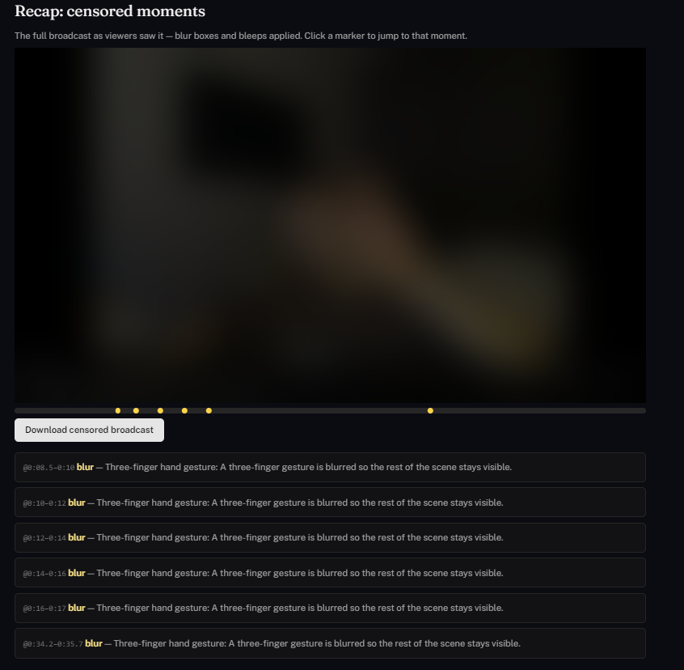
*Post-show: the censored-moments recap with reasons and the censored download.*

## Testing

```bash
npm run typecheck   # strict TS, must be clean
npm test            # full suite incl. vision/fuzzy/realtime protocol tests (223 tests)
npm run prove:relay # end-to-end relay proof with the real 12s delay (~17s)
npm run build       # production build incl. middleware + sitemap
npm run smoke       # one cheap live call per Meta model (needs MODEL_API_KEY)
npm run eval:gestures -- <clips-dir>  # backend accuracy/latency/cost table ($1 cap)
```

- `eval:gestures` scores vision backends on labelled clips (accuracy + latency +
  cost per option) — this is what justified Spark over SAM.
- `soak:live` replays real captured moderation inputs (`DEBUG_CAPTURE=1`) through
  the live pipeline to shake out latency/queue regressions before showtime.

## Limitations and honest tradeoffs

- **Single concurrent relay stream** shared by all "live" show pages; tickets gate
  access, not the transport. Multi-show isolation is future work.
- **SQLite file is local** (no replication); in-memory rate limits reset on restart.
- **The 12s delay is the product tradeoff.** It buys the moderation time budget, but
  viewers are always 12s behind the stage and comedians can't do real-time crowd
  work through the platform.
- **Vision recall is sampling-bound.** 4 frames per 2s chunk (~500ms spacing) can
  miss very brief gestures; small/distant hands are the known weak spot. The eval
  recall numbers still need real labelled gesture clips — only clean-path eval has
  run, plus live smoke tests.
- **Word timing is approximate.** The realtime path bleeps word ±250ms (emission lag
  corrected); the file fallback bleeps whole chunks where realtime didn't cover.
- **SAM path is legacy.** It measured ~36 $/h and 4–20s latency vs Spark's ~$3–5/h
  and ~2–4s; it stays behind `VISION_BACKEND=sam` for comparison only.
- **No real payments, email, or recording storage** — all intentionally mocked or
  omitted for the hackathon scope.

## Site features (beyond moderation)

The platform around the pipeline: accounts with viewer/comedian roles (bcrypt,
signed sessions, CSRF guard, 18+), show grid with search, categories and tags, show
pages with countdown and viewer-local start times, mock ticket checkout, comedian
studio with show manager and revenue calculator, self-hosted brand/SEO setup, and
template legal pages (terms, privacy, moderation policy with human appeals).

## Project structure

```text
Comedically Online
├── server.ts                  # custom server: Next.js + WebSocket relay
├── src/
│   ├── app/                   # App Router pages (shows, studio, watch, legal, …)
│   ├── components/
│   │   ├── BroadcastStudio.tsx       # comedian capture, viewer view, timeline, log
│   │   ├── ShowPlayer.tsx            # viewer MSE player, overlays, countdown/ended
│   │   ├── CensoredBroadcastPlayer.tsx # post-show recap + censored download
│   │   ├── ModerationFeed.tsx        # live moderation log UI
│   │   └── RulebookAccept.tsx        # rulebook acceptance gate
│   ├── server/
│   │   └── stream-host.ts     # relay: ring buffer, release gate, fail-closed logic
│   ├── moderation/
│   │   ├── rulebook.json      # THE rules (v1.0.0): waffle, three fingers, nose
│   │   ├── index.ts           # moderateChunk: orchestrates audio + visual per chunk
│   │   ├── realtime.ts        # Meta realtime ASR WebSocket client
│   │   ├── transcribe.ts      # Meta Voice Transcribe (file) + fallback windows
│   │   ├── fuzzy.ts           # Turkish-aware banned-word matcher
│   │   ├── judge.ts           # Spark comedy-aware judge
│   │   ├── spark-vision.ts    # Spark frame classifier + gesture state machine
│   │   ├── detect-visual.ts   # backend switch (spark/sam/gate) + frame sampling
│   │   ├── mock.ts            # scripted mock decisions (free demo mode)
│   │   └── cost.ts            # spend tracking + cap
│   └── lib/
│       ├── delay-buffer.ts    # 12s release timing
│       ├── censor-plan.ts / censor-render.ts  # recap plan + on-device censored render
│       ├── overlay-timing.ts  # viewer bleep/blur window mapping
│       └── playback.ts        # teardown, stall/gap recovery, buffer trim
├── scripts/
│   ├── prove-relay.ts         # end-to-end relay proof (real 12s delay)
│   ├── eval_gestures.ts       # vision backend accuracy/latency/cost eval
│   ├── soak-live.ts           # replay captured chunks through live moderation
│   ├── smoke.ts               # one cheap live call per Meta model
│   └── seed.ts / seed-tags.ts # demo data
└── tests/                     # 223 tests incl. tracker, fuzzy, realtime, relay
```
